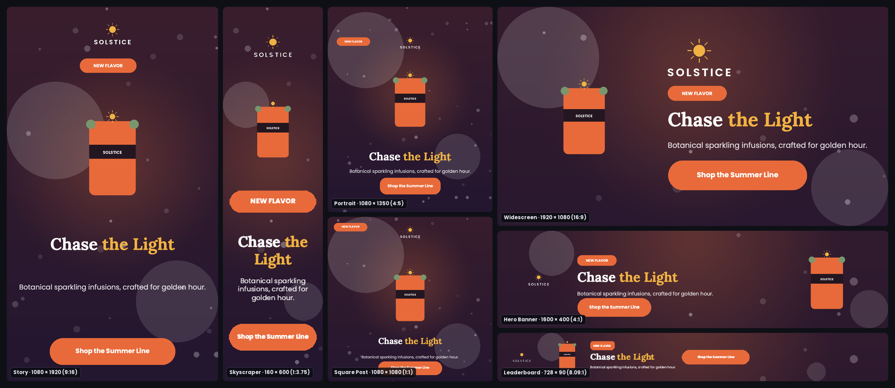
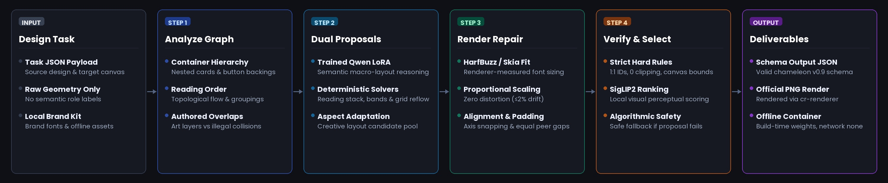
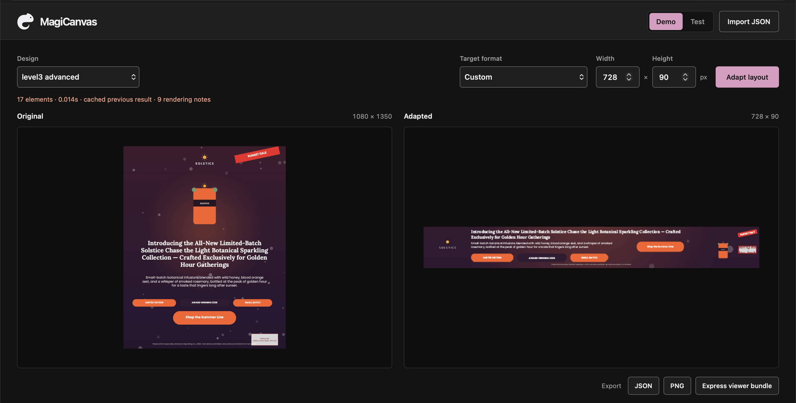

# MagiCanvas

An offline, agentic design-resizing engine for Adobe's Chameleon challenge. Built as an autonomous brand-studio assistant, it operates via an agentic **Generate → Repair → Verify** loop: a lightweight Qwen LoRA proposes semantic macro-layouts; source-aware structural reflows provide alternatives; rendered text metrics and geometric critics repair and select the best result. Element IDs, copy, font families and original assets are strictly preserved. No cloud inference or image generation.





```text
input/<task>.json (source design + target canvas)
        │
        ▼
  1. ANALYZE   ──► Infer lockups, containers, reading order & attachments
        │
        ▼
  2. PROPOSE   ──► Hybrid candidates:
                   ├─ Qwen3-0.6B LoRA (learned macro-composition)
                   └─ Deterministic reflows (stack/grid, macro-band, proportional)
        │
        ▼
  3. REPAIR    ──► Renderer-measured font fitting, axis snapping,
                   padding, equal peer gaps, proportional artwork scaling
        │
        ▼
  4. VERIFY    ──► Hard rule checks (bounds, IDs, collisions, clipping)
        │          + Local SigLIP2 bounded perceptual tie-breaker
        ▼
output/<task>_output.json (schema-valid resized design)
output/<task>_output.png  (official cr-renderer output)
```

## Output contract and guarantees

The engine enforces strict guarantees required by the competition specification:

- **1:1 Element and ID preservation:** Every source element ID is preserved exactly once. No elements are dropped, duplicated, or hallucinated.
- **Content & typography integrity:** Copy text, styles, and font families remain unchanged; only positions, dimensions, integer font sizes, and text wrapping adjust.
- **Aspect ratio fidelity:** Foreground image aspect ratios are preserved within ≤2% drift (well within the official 5% limit). Background backdrops resize to cover.
- **Canvas containment:** All elements and rendered glyph bounds remain strictly within the target canvas boundaries.
- **Fully offline & self-contained:** Operates inside Docker with `--network none`. Weights download at build time only; zero network calls or external APIs at runtime.

## Docker — stage-one evaluation

The selected champion LoRA is published at `NeoliteNexus/magicanvas-qwen3-0.6b-lora`, pinned to commit `09216ebcf0260889f84d21a723ce4ecacdc58e5b`. The final build fetches this exact revision and fails rather than silently evaluating the pretrained base without our adapter.

```bash
docker build --platform linux/amd64 --target submission \
  --build-arg QWEN_MODEL_REVISION=c1899de289a04d12100db370d81485cdf75e47ca \
  --build-arg QWEN_ADAPTER_REPO=NeoliteNexus/magicanvas-qwen3-0.6b-lora \
  --build-arg QWEN_ADAPTER_REVISION=09216ebcf0260889f84d21a723ce4ecacdc58e5b \
  -t magicanvas .
docker run --rm --network none \
  -v "$PWD/input:/app/input" -v "$PWD/output:/app/output" magicanvas
```

Run from the repository root. Each `input/*.json` task contains `source` and `target_canvas`; results are `output/<task>_output.json` and `_output.png`. Dependencies and weights download at **build time only**. The supplied runner, renderer, schema, official samples and brand kit are unchanged. Level 3's missing holiday asset is intentional.

The pinned public adapter is now wired into the final build. A final offline Docker build/run is still to be verified.

## Optional: native Python and preview

Requires Python 3.10+ and the selected adapter installed at `models/qwen3-layout-lora-v2/`. This path does not require Docker.

```bash
python3 -m venv .venv
source .venv/bin/activate
pip install -r requirements.txt
python scripts/fetch_qwen.py --model Qwen/Qwen3-0.6B --revision c1899de289a04d12100db370d81485cdf75e47ca
python scripts/fetch_siglip.py
export MAGICANVAS_QWEN_ENABLED=1 MAGICANVAS_REQUIRE_QWEN_ADAPTER=1
python -m engine.main
# Optional interactive preview:
python viewer/server.py --port 5050
```

Open **http://127.0.0.1:5050** for the interactive preview. The companion Adobe Express add-on is located in `viewer/express/` (see [viewer/README.md](viewer/README.md)).



## Evaluation and benchmark results

Measured against the official `cr-renderer` and schema validation:

| Test Cohort | Cases | Formats / Description | Hard Rules Pass | ID & Schema Integrity |
|---|---|---|---|---|
| **Development Cohort** (`config/regression_review.json`) | 38 | 18 official conversions, 8 alternate conversions, 12 complex dataset cases | 100% | 100% |
| **Multi-Format Benchmark** | 89 | 1080×1080 (square), 1080×1350 (portrait), 1080×1920 (story), 1600×400 (banner), 728×90 (leaderboard), 160×600 (skyscraper) | 100% | 100% |
| **Official Samples (Levels 1–3)** | 3 | Square, landscape card, and dense holiday promotional card | 100% | 100% |

The static review viewer for development regressions runs at `http://127.0.0.1:8766/review/main_engine_qwen_outputs/index.html`. Full evaluation details: [EVALUATION.md](docs/EVALUATION.md).

## Training data scale and model research

To discover robust layout generation and visual ranking, extensive training, fine-tuning, and ablation campaigns were conducted across multiple model families:

- **Dataset & Preference Scale:**
  - **Crello v5.1.0 Dataset:** 1,122 curated cross-aspect design training pairs, 309 validation pairs, and 89 held-out reference pairs mined by matching element inventories, typography, and content across radical canvas conversions, strictly isolated by design family to eliminate data leakage.
  - **Human Preference Alignment:** 178 pairwise human preference annotations across multi-aspect layout comparisons to evaluate visual balance and rank candidate compositions.
  - **Visual Ranking Gating:** SigLIP Base (~375M parameters) and SigLIP2-NaFlex evaluated on full rendered design bitmaps to break ties between candidate layouts.

- **Explored & Trained Model Families:**
  - **Champion Production Model:** `Qwen3-0.6B` + rank-16 LoRA adapter (~10M trainable parameters; pinned commit `09216ebcf0260889f84d21a723ce4ecacdc58e5b`), selected for its low-latency offline CPU/Metal execution and robust JSON adherence.
  - **Larger Text & Code Models:** `Qwen3-1.7B` (trained rank-16 LoRA), `Qwen2.5-1.5B-Instruct` (prompt-following), `Qwen2.5-Coder-1.5B-Instruct` (structured JSON generation), `Qwen3.5-0.8B`, and `Qwen3.5-2B`.
  - **Multimodal Vision-Language (VLM):** `Qwen3-VL-2B-Instruct` pilot targeting 196 attention projection modules across 28 layers with image-aware layout grammar trained directly on design renders.
  - **Perceptual Rankers:** Local `SigLIP2 Base` and `SigLIP2-NaFlex` dynamic resolution embedders, alongside a 10-feature structural ranker.

## Model operation limits

| Item | Current implementation |
|---|---|
| Generator | Lightweight **Qwen3-0.6B** plus its trained LoRA adapter; greedy, non-thinking inference |
| Visual ranking | Local SigLIP2 Base (~375M parameters), bounded tie-breaker after defect checks |
| Token budget | Combined context ≤8,192; prompt ≤6,000 with an inventory-sized output reserve; output ≤4,096 |
| Hardware | Designed for local Apple Silicon, including M5 Pro: native macOS uses Metal FP16. CUDA uses BF16/FP16; CPU uses FP32. **Linux/amd64 Docker on Mac uses CPU, not Metal.** Speed varies with design density; no M5 Pro Docker latency guarantee is claimed |
| Offline behavior | Weights loaded locally; no runtime downloads or API calls. Dense/extreme layouts can still lose readability |
| Swapping models | Set `MAGICANVAS_QWEN_DIR` and `MAGICANVAS_QWEN_ADAPTER_DIR` to a compatible base/adapter pair and restart. Supported text-model loading includes Qwen3-1.7B and Qwen2.5-1.5B-Instruct; each needs its own adapter. The VL-2B image-aware provider remains experimental, not the production default |

> [!TIP]
> **Swappable Model Architecture (Hackathon Bonus Feature):** The engine is decoupled from model weights. Evaluators can hot-swap the layout proposal base model and LoRA adapter without container rebuilds by passing `MAGICANVAS_QWEN_DIR` and `MAGICANVAS_QWEN_ADAPTER_DIR`.

### Supported real-world platforms and standard canvas catalogue

Scoring target sizes are drawn from standard real-world formats matching common designer workflows:
- **Instagram Square Post:** 1080 × 1080 (1:1 aspect ratio)
- **Instagram Portrait Post:** 1080 × 1350 (4:5 aspect ratio)
- **Instagram / TikTok Story & Reel:** 1080 × 1920 (9:16 vertical video/story)
- **YouTube Thumbnail / Landscape Video:** 1920 × 1080 (16:9 widescreen)
- **Hero Web Banner:** 1600 × 400 (4:1 panoramic banner)
- **IAB Standard Leaderboard Banner:** 728 × 90 (8.09:1 wide banner)
- **IAB Standard Skyscraper:** 160 × 600 (1:3.75 vertical tower)
- **Custom / Edge Sizes:** Arbitrary user-defined rectangles supported via preview and CLI.

## Implemented algorithms

- Source relationship graphs: nested containers, backing ownership, attachments and repeated sibling groups.
- Learned proposals plus measured stack/grid, macro-band, editorial/banner and source-proportional candidate reflows; bounded missing-ID recovery.
- Renderer-measured text fitting and tracking, shared-axis snapping, control padding and equal edge-to-edge peer gaps.
- Proportional artwork scaling, visible-alpha geometry, source edge anchors and safe margins.
- Deterministic placement constraints and whole-lockup contrast/clean-zone repairs that respect source-supported overlaps.
- Render-grounded ID/bounds, glyph-fit, collision and contrast checks; candidate-family quotas and bounded perceptual ranking.

## Repository layout

```text
├── engine/              # Resizing orchestrator, Qwen seed, heuristic reflows, critic & repair logic
├── renderer/            # Vendored official cr-renderer and transformer-converter
├── brand_kit/           # Local Solstice assets and brand font families
├── input/               # Task JSON files (source design + target_canvas)
├── output/              # Generated schema JSON and rendered PNG outputs
├── models/              # Local Qwen base model and trained LoRA adapter weights
├── viewer/              # Port 5050 interactive preview server & Adobe Express add-on
├── config/              # Regression review definitions and model configurations
├── scripts/             # Model fetchers, regression packagers, profile diagnostics
├── tests/               # Regression suite, review evidence tests, and invariant checks
└── docs/                # Architecture, runbooks, and algorithm decisions
```

## Tradeoffs and known limitations

- **Learned generative diversity vs. CPU latency:** Running a learned 0.6B Qwen model + LoRA alongside deterministic reflows unlocks non-linear structural adaptations that fixed templates cannot invent. However, in emulated `linux/amd64` Docker on CPU, each task takes ~5–15 s, whereas purely heuristic engines finish in tens of milliseconds. We chose structural quality and candidate diversity over raw millisecond throughput.
- **Rule invariants vs. extreme canvas density:** The competition contract strictly forbids dropping elements or truncating text copy. On extreme aspect ratios (such as 320×50 mobile banners or 160×600 skyscrapers), all source text and elements must physically fit. The engine shrinks copy down to readable micro-floors (7–8 px) to guarantee zero clipping and zero collisions, rather than illegally removing low-priority elements.
- **Render-grounded verification vs. candidate scoring cost:** Instead of scoring layouts solely on abstract bounding-box heuristics, MagiCanvas renders text with exact font metrics (`cr-renderer` / Skia) to verify glyph boundaries, intentional overlaps, and contrast. This prevents subtle text clipping and contrast failures at the cost of additional candidate rendering cycles.
- **Algorithmic solver safety vs. neural ambition:** The engine is fully general with **zero hardcoded templates, zero sample ID matching, and zero design-specific shortcuts**. Candidate layouts are generated both by the neural model (Qwen3-0.6B LoRA) and by generic algorithmic reflow solvers (reading-order stack/grid reflows, macro-band solvers, and proportional geometry transforms calculated on the fly). If a neural proposal violates hard bounds, drops an ID, or introduces unrepairable glyph collisions, the engine safely selects a candidate from its general algorithmic reflow solvers that satisfies all geometric and typographic verification.
- **Preservation of intentional starter deficiencies:** The Level 3 holiday asset is intentionally missing from `brand_kit/assets/`. MagiCanvas preserves the original asset reference as authored, rendering the official diagnostic placeholder rather than hallucinating new pixels or silently deleting the element.
- **Cross-platform font rasterization:** Sub-pixel text metrics (Skia / FreeType on Linux vs. CoreText / Metal on macOS) can exhibit minor fractional-pixel variances. All formal evaluation and deterministic verification are anchored in the containerized Linux environment.

[Architecture](docs/IMPLEMENTATION.md) · [Starter-file integrity audit](docs/STARTER_INTEGRITY.md) · [Evaluation](docs/EVALUATION.md) · [Training](docs/TRAINING_RUNBOOK.md) · [Official rules](RULES.md). Historical experiments are retained in a local, Git-ignored archive and are not current performance claims.
